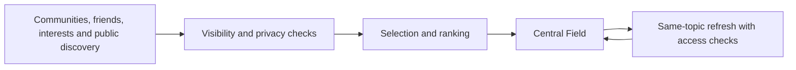
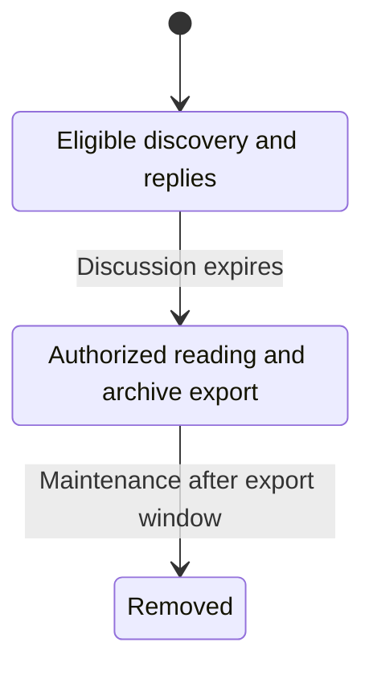
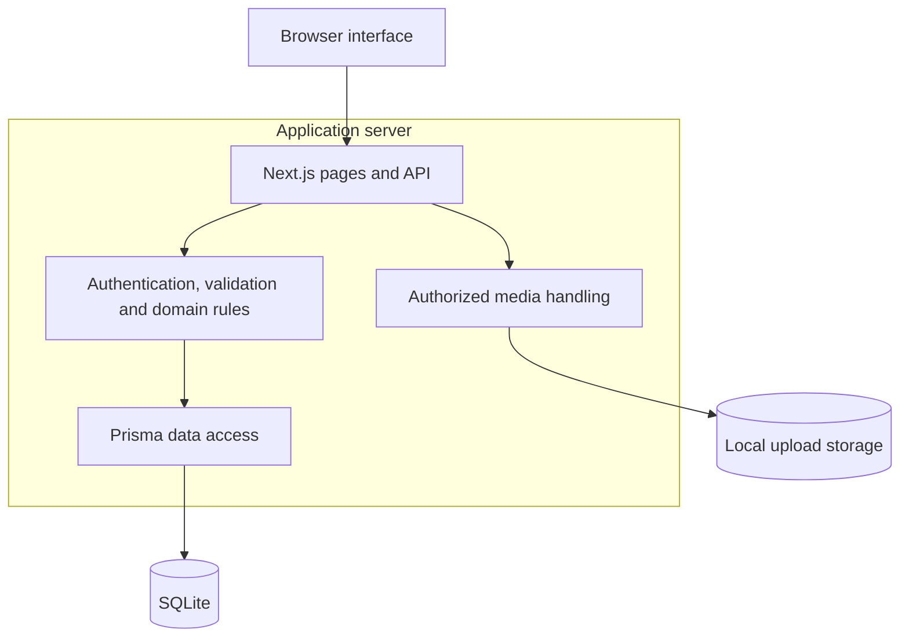
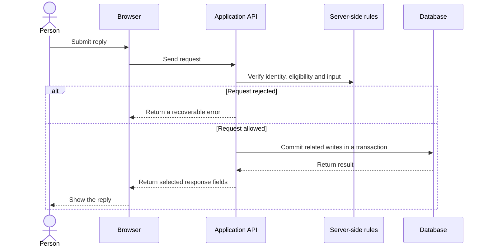
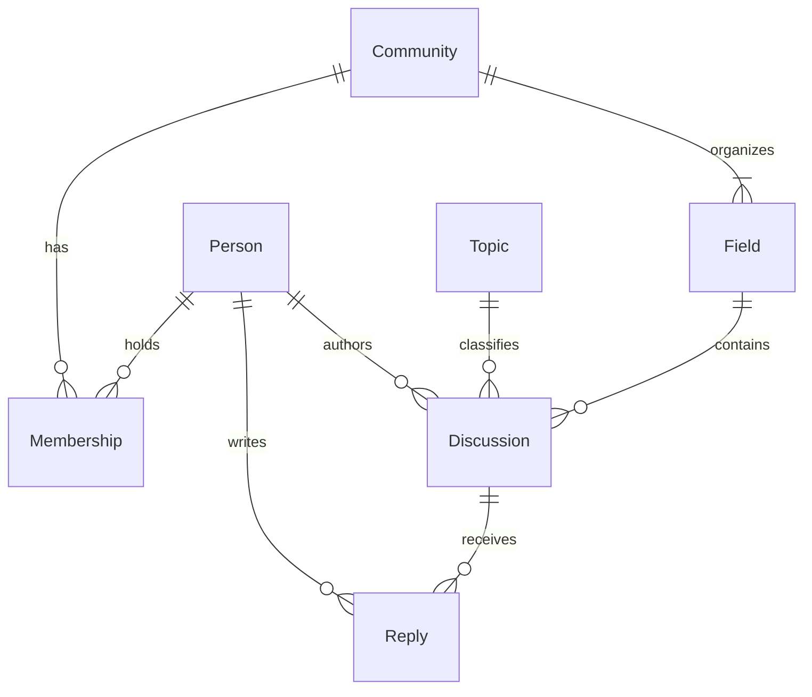
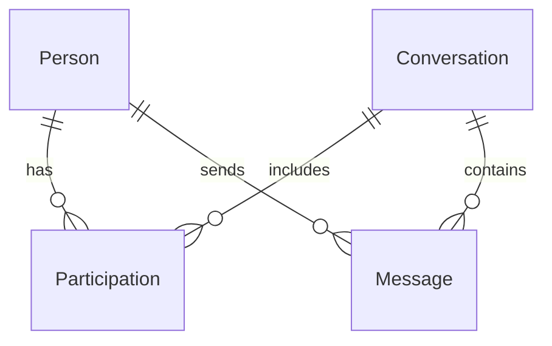

# Bubbles

**A full-stack social platform in alpha, built around topic-based conversations.**

I want Bubbles to be a place where people can find conversations they actually want to be part of, without the pressure to keep scrolling or turn every disagreement into an argument.

This README walks through the product, how the main systems fit together, the development challenges, and what has been tested. The diagrams show the broad design; the application source and detailed internal documentation remain private while the product develops.

Here is a video walkthrough of the project demonstration!

https://youtu.be/p5OGBDskJ4k

## Explore the project

- [The idea and design](#1-the-idea-and-design)
- [Bubbles, Fields, Spaces, and Clouds](#2-bubbles-fields-spaces-and-clouds)
- [Accounts and the showcase](#3-accounts-and-the-showcase)
- [The Central Field and refresh](#4-the-central-field-and-refresh)
- [Creating and joining conversations](#5-creating-and-joining-conversations)
- [Communities and discovery](#6-communities-and-discovery)
- [Friends, messages, and personal controls](#7-friends-messages-and-personal-controls)
- [Stack and architecture](#8-stack-and-architecture)
- [Development challenges](#9-development-challenges)
- [Testing and iteration](#10-testing-and-iteration)
- [Following a request](#11-following-a-request)
- [ER diagrams](#12-er-diagrams)
- [Security verification](#13-security-verification)
- [Security follow-up](#14-security-follow-up)
- [Current status and next steps](#15-current-status-and-next-steps)

## 1. The idea and design

Being interested in a topic does not mean you want to join every conversation about it. You might enjoy discussing games, for example, but want a different question, group, or perspective from the first discussion you find.

Bubbles lets you keep the topic and look for another conversation. I want that choice to be part of the experience, alongside choosing your communities, interests, and personal boundaries.

The design uses a Frutiger Aero style: blue sky, grass, glass, and floating bubbles. I want the site to feel open and inviting. The homepage introduces the product through selectable explanations, a refresh example, and community illustrations. Inside the app, the floating Field carries that idea into browsing. A list alternative gives people another way to read and navigate.

## 2. Bubbles, Fields, Spaces, and Clouds

| Name | What it means |
| --- | --- |
| **Bubble** | A topic-based discussion with opening text and replies. |
| **Field** | A collection of bubbles. |
| **Space** | A community with one Field. |
| **Cloud** | A community with multiple Fields for organizing conversations. |
| **Central Field** | Your mixed view of conversations from communities, friends, interests, and public discovery. |

Spaces and Clouds are two forms a community can take. Clouds do not contain Spaces. Community growth can move a Space into a Cloud, while sustained lower membership can move a Cloud back into a Space with its Fields merged. These transitions need to preserve content and membership.

## 3. Accounts and the showcase

Normal accounts can choose interests, join communities, create discussions, add friends, and send messages according to their permissions and privacy settings.

There are two different demonstration experiences:

- **Read-only trial:** a restricted account with curated sample content for browsing.
- **Local interactive showcase:** a separate environment with fictional people, prepared discussions, messages, invitations, and an archive example. It supports normal app actions, account switching, and restoring the starting state.

The showcase lets me demonstrate both sides of a conversation without repeatedly registering users or accumulating content. Its switching and reset controls exist only in that environment; ordinary users cannot switch into another person's account.

A publicly hosted interactive demo is not being offered through this repository.

## 4. The Central Field and refresh

The Central Field brings together eligible conversations from joined communities, accepted friends, chosen topics, and public discovery. People can adjust which sources contribute to it.

The feed uses ranking. Reply volume does not push a conversation higher. I want people to understand why something appears and have a way to change what they see.

Refreshing a bubble looks for another accessible discussion on the same topic, preferring a different Field when a suitable alternative exists. It respects audience, membership, blocks, hidden discussions, expiry, and recent choices.

For example, refreshing a Gaming discussion about replaying games might show another Gaming conversation in a different community. It does not change the topic or grant access to private content. If no suitable alternative exists, refresh cannot invent one.

## 5. Creating and joining conversations

Starting a bubble means choosing its destination, topic, title, opening text, prompt, and lifetime. Standalone discussions can use a public or accepted-friends audience. Community discussions follow their room's access rules.

Replies can use **Open**, **Support**, **Challenge**, or **Curious** stance labels. These give people a way to explain how they are entering a conversation. They support the experience I want to build, but they do not replace reporting or moderation.

A person who discovers an eligible public Space discussion can join the Space from the bubble, then participate according to the community rules.

Conversations have a lifetime. Expiry stops replies and removes the discussion from active discovery. Authorized readers have a limited JSON export window before maintenance removes it. The export contains media references rather than bundling images for offline use.

Removal depends on maintenance running. Expiry and deletion are separate steps.

## 6. Communities and discovery

Spaces keep discussions in one Field. Clouds offer multiple Fields, so a larger community can organize different areas of conversation.

Communities can be public or private. Owners, moderators, and members have different permissions. Invitations support entering private communities, and management controls cover membership, roles, discovery settings, and Cloud Fields.

General room chat is optional. Spaces do not allow image replies, while Clouds have image-posting permissions.

Discovery helps people find conversations beyond the communities they already know. Private community activity is excluded from public topic promotion and public discovery. Privacy also matters for counts and summaries, where information could otherwise leak without exposing a whole discussion.

## 7. Friends, messages, and personal controls

Friendship is an accepted relationship. A one-way follow does not grant access to a friends-only discussion.

Messaging supports direct conversations and small group chats, including text and images. Recipient preferences and blocking affect who can start conversations and what content is returned. Existing groups have documented policy exceptions that need to be explained and tested. Messages are **not end-to-end encrypted**.

People can also hide discussions, block users, manage interests, and adjust feed sources. Notifications bring together unread conversations, friend requests, and community invitations.

The interface includes responsive reading layouts, keyboard interaction, visible focus, reduced-motion support, and the list alternative to floating bubbles. A full accessibility assessment is still needed.

## 8. Stack and architecture

| Layer | Technology |
| --- | --- |
| Application framework | Next.js |
| Interface | React and TypeScript |
| Styling | Tailwind CSS and custom styles |
| Data access | Prisma |
| Current database | SQLite |
| Current messaging updates | Polling |
| Current image storage | Local disk |

This is one application with internal responsibilities, rather than separately deployed services. Pages and API handlers use shared rules for access, relationships, discovery, and lifecycles.

The browser is an untrusted client. Hiding a button is useful for the interface, but the server still needs to validate the request and enforce permissions. Uploaded files are another untrusted input.

## 9. Development challenges

The main work is keeping the rules consistent across features. A discussion can appear through a Field, a community page, or a direct link. Each entry point needs the same access boundaries.

| Challenge | How the project approaches it |
| --- | --- |
| Relevant discovery without private-content leakage | Check eligibility before selecting and ranking conversations. |
| Same-topic refresh | Find another eligible discussion while accounting for visibility and recent choices. |
| Relationships changing over time | Use current friendship, membership, audience, and block state. |
| Related database writes | Use transactions where changes need to succeed or fail together. |
| Expiring discussions | Separate active participation, read-only export, and maintenance. |
| Community transitions | Preserve content, membership, and relevant state when the structure changes. |
| A floating interface on different screens | Combine layout rules with readable panels, list mode, keyboard access, and reduced motion. |

Development has involved revisiting existing flows as well as adding features. Friendship, for example, affects discovery, private audiences, and messaging. Expiry affects replies, discovery, and archives. A change to one rule needs checks in the other places that depend on it.

## 10. Testing and iteration

Focused tests check individual rules with controlled inputs and expected results. Deterministic rules should produce the same result for the same inputs.

| Area | Examples of what is checked |
| --- | --- |
| Ranking | Source mixing, stable ordering, and duplicate handling. |
| Lifetimes | Active, expired, and archive-window boundaries. |
| Media validation | Supported formats, signatures, and safe file names. |
| Layout and motion rules | Bubble bounds, resizing, readable selected panels, and collision behavior. |

HTTP integration tests send requests to a running app to exercise several parts together: authentication, input validation, permissions, application rules, and database changes. They use separate database, upload, and build paths so tests can create and remove data without resetting the working database.

**Recorded verification on November 16, 2026:**

- TypeScript checks and the production build passed.
- The normal isolated integration suite passed, including the read-only trial restrictions.
- Showcase checks passed for refresh, two-way messaging, group creation and messages, bubble creation, interests, friendship, blocking, joining, invitations, archives, reset cleanup, and a data-creation guardrail.
- Fourteen showcase pages returned successful HTML with the account-switch and reset controls present.

The page checks verified server rendering, not browser appearance or interaction. Browser automation was unavailable for that review. The full earlier security assessment was not rerun as part of those showcase checks. These are dated results, not a claim that every future revision has passed.

## 11. Following a request

Submitting a reply is a useful example of how the layers work together.

The server checks the session, write limit, discussion access, posting eligibility, and input. An image attachment also needs the appropriate permissions and ownership checks.

Creating the reply and updating the discussion timestamp happen in a transaction, so those writes succeed or fail together. The response includes selected fields rather than returning the entire stored record.

A transaction protects the work inside it. Permission checks performed before it do not automatically become atomic with the write; concurrent permission changes need their own analysis and tests.

## 12. ER diagrams

These entity-relationship diagrams show the product's broad relationships. They omit physical schema fields, keys, indexes, security tables, and implementation details.

Read `||` as exactly one, `o{` as zero or more, and `|{` as one or more. A Discussion can have zero or more Replies, while each Reply belongs to one Discussion.

### Communities and discussions

Membership connects people to communities. Fields organize discussions, topics classify them, and replies belong to discussions. Community combines Spaces and Clouds for this explanation; it does not imply a single physical Community table. Personal Fields are omitted from this simplified view.

### Messaging

Participation represents who belongs to a conversation. A message records content within it and who sent it. Keeping participation separate from message authorship makes those responsibilities clearer.

The underlying engineering involves deciding which invariants belong in database constraints, which need application checks, and which related updates require transactions. These diagrams explain the relationships without publishing the physical schema.

## 13. Security verification

Security testing includes requests that should fail, alongside checks that protected data remains unchanged. A rejected response alone is not enough if an unauthorized change still reaches the database.

Recorded local assessments from **November 10–11, 2026** covered these areas:

| Area | Recorded observation |
| --- | --- |
| Authentication | Invalid token claims and unsupported token forms were rejected in selected checks. |
| Session lifecycle | Logged-out session replay failed while independent sessions remained valid. |
| Object and role access | Selected privilege-escalation and cross-community edit attempts failed without changing the protected record. |
| Protected profile fields | An allowed profile change did not overwrite selected protected fields supplied in the same request. |
| Response exposure | Selected private fixture values were absent from inspected API, HTML, and component-stream responses. |
| Messaging | Selected outsider reads and restricted new conversations were denied; block filtering and documented policy exceptions were checked. |
| Request origin | Selected cross-origin mutations were rejected despite header tampering. |
| Public exposure | Selected sensitive paths were unavailable, and production bundle checks covered browser source-map exposure. |

Some test tokens were deliberately signed with a disposable test secret. That allowed claim validation to be tested separately from signature validity.

The assessments used disposable local data. Production-mode HTTP checks still ran over loopback with cookies supplied by the harness. They did not establish real hosted TLS, reverse-proxy, cloud-storage, or external-provider behavior.

These are bounded observations, not an independent audit or certification. Selected absent secrets do not prove every response safe, and one escaped payload does not establish the absence of all XSS. Later edits require fresh verification.

## 14. Security follow-up

The historical assessment identified further work in storage and resource budgets, read pagination and concurrency limits, image processing, deployment configuration, and optional provider spending controls. Their resolution has not been comprehensively reverified for this public overview.

The broader lesson is that an individual control can work while leaving a larger problem unfinished:

- A per-request limit does not necessarily bound total resource consumption.
- Checking an input format does not replace safely processing its contents.
- Authentication does not replace checking access to the specific object requested.
- Local checks do not establish that a deployed proxy or storage service is configured correctly.

The next step is to address those boundaries and verify both normal behavior and rejected cases, including relevant concurrency and deployment conditions. Detailed findings, payloads, and reproduction steps remain in private engineering records.

## 15. Current status and next steps

Bubbles is a **working alpha**. The core flows are implemented, and I am continuing to refine the experience and the work needed for a public beta.

| Area | Work still needed |
| --- | --- |
| Hosting and persistence | Durable hosting, database and media-storage decisions, and versioned migrations. |
| Operations | Scheduled maintenance, monitoring, backups, and tested recovery. |
| Security | Further resource controls, image processing, deployment verification, and browser security review. |
| User support and safety | Reporting and moderation, account recovery, and account deletion workflows. |
| Experience | Further accessibility, mobile, keyboard, and screen-reader review, plus fuller group management. |

SQLite, local disk, and polling keep the current development setup straightforward. A public service needs a plan for persistence, failures, recovery, and growth beyond that local setup. A successful build is one check toward that work, rather than proof of production readiness.

The project brings together product thinking, frontend interaction, API design, relational modeling, permissions, transactions, testing, and operational planning. The goal I want to keep building toward is a place where people can choose a topic, find a conversation, and hear a different perspective when they want one.
